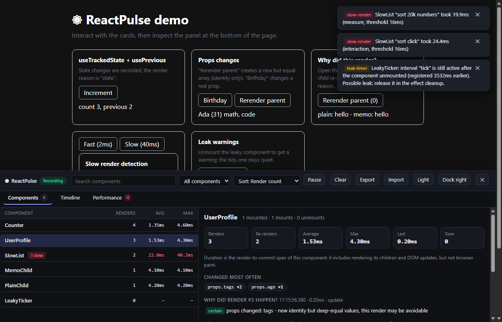
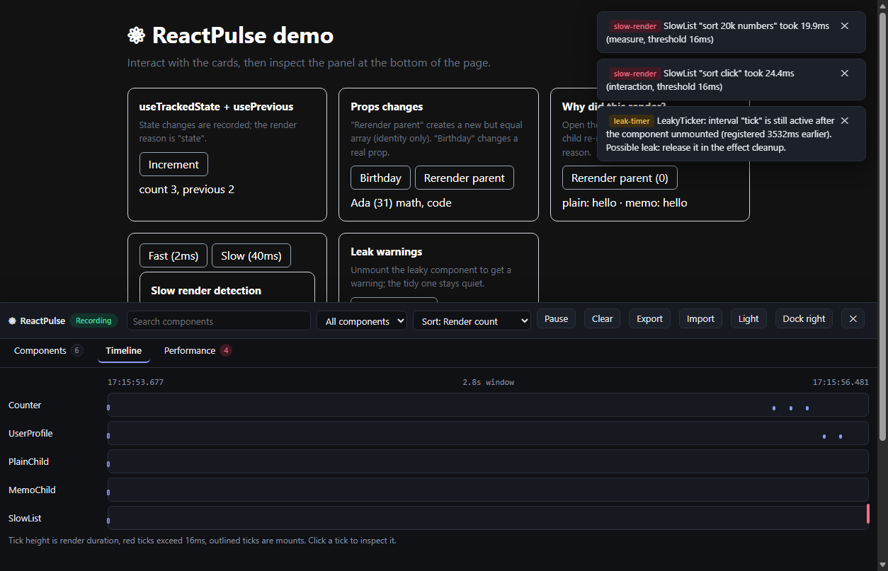
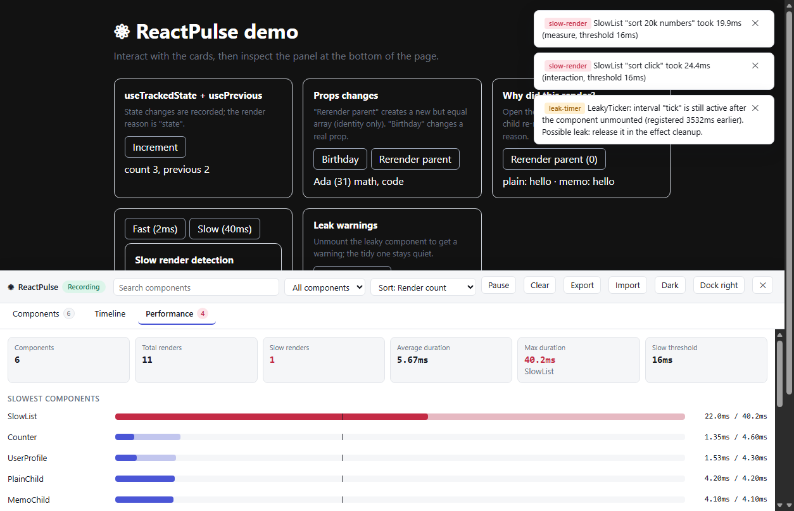
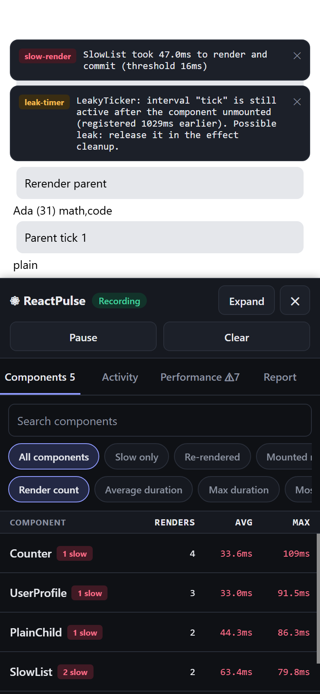
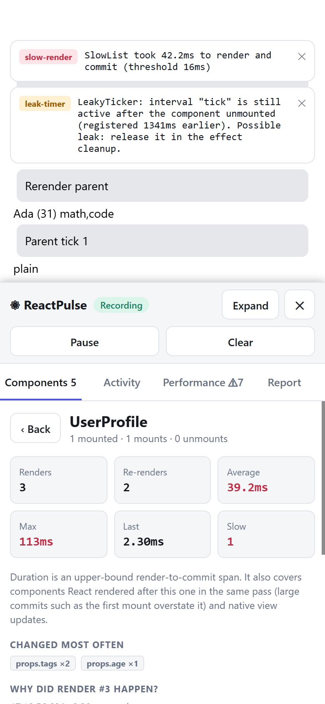

# ⚛ ReactPulse

Lightweight React and **React Native** debugging and performance inspection: render tracking, "why did this render?", slow-render detection, leak warnings and a developer dashboard (a lazy-loaded web dashboard, and a native one for React Native). TypeScript-first, built only on public React APIs.

```bash
npm install reactpulse-devtools
```

- **Small.** Using the hooks costs **~4.5–5.0 KB gzip** (measured, see [Bundle size](#bundle-size)). The dashboard is a separate lazy chunk and is replaced by a 0.08 KB stub in production builds.
- **Honest.** Causes that React does not expose are labelled **probable**, never presented as fact. See [Limitations](#limitations).
- **Safe.** Records after commit (never during render), never reads Fiber internals, works with StrictMode and SSR.
- **Web and mobile.** One set of hooks for React (Vite, Next.js) and React Native, with a dashboard for each. See [React Native](#react-native).
- **Off when you want it off.** Disabled in production by default; a disabled hook costs ≈ 0.8 µs per render.



> Screenshots are of the demo app in `examples/demo`.

## Contents

- [Quick start](#quick-start) · [Hooks](#hooks) · [Why did this render?](#why-did-this-render) · [Performance monitoring](#performance-monitoring)
- [Dashboard](#dashboard) · [Memory-leak warnings](#memory-leak-warnings) · [Reports](#export-and-import-reports)
- [Configuration](#configuration) · [Next.js](#nextjs) · [React Native](#react-native) · [Production](#production-builds)
- [Performance considerations](#performance-considerations) · [Bundle size](#bundle-size) · [Limitations](#limitations) · [Compatibility](#compatibility) · [Contributing](#contributing)

## Quick start

Hooks work on their own, with no provider and no dashboard:

```tsx
import { useRenderTracker } from "reactpulse-devtools";

function UserProfile({ name, age }: { name: string; age: number }) {
  useRenderTracker("UserProfile", { props: { name, age }, log: true });
  return <div>{name} - {age}</div>;
}
```

Console output for a re-render (illustrative; in the browser it is a collapsed, styled group, and the table lists previous and current values side by side):

```
⚛ UserProfile #2 0.84ms
props changed: age
┌───────────┬──────────┬─────────┐
│ (index)   │ previous │ current │
├───────────┼──────────┼─────────┤
│ props.age │ 36       │ 37      │
└───────────┴──────────┴─────────┘
since previous render: 1204ms
```

Add the provider to get configuration plus the dashboard (loaded lazily, only when monitoring is enabled):

```tsx
import { ReactPulse } from "reactpulse-devtools";

export function Root() {
  return (
    <ReactPulse config={{ threshold: 16, showNotifications: true, trackRenders: true }}>
      <App />
    </ReactPulse>
  );
}
```

`<ReactPulse>` never re-renders `children`. Everything is disabled when `NODE_ENV === "production"` unless you opt in.

## Hooks

| Hook | Purpose |
| --- | --- |
| `useRenderTracker(name, options?)` | Records every committed render: count, duration, time between renders, changed props/state/context/deps and likely reasons. |
| `useWhyDidYouRender(name, props, options?)` | Same engine, tuned for the console: logs each re-render with its reasons and previous/current values. |
| `usePrevious(value)` | Value from the previous committed render. |
| `useMountTracker(name?, { log? })` | Records mount/unmount and lifetime; returns a stable `isMounted()`. |
| `usePerformanceTracker(name, options?)` | Render timing plus `measure()` and `startInteraction()` helpers. |
| `useTrackedState(initial, name?)` | `useState` that records each committed change. |
| `useLeakTracker(owner)` | Timer/listener/subscription helpers that warn about leaks on unmount. |

All hooks are unconditional (Rules of Hooks), never trigger a render themselves and keep the cost of a disabled call to a few ref/effect registrations.

### `useRenderTracker`

```tsx
const info = useRenderTracker("Card", {
  props: { id, title },              // compared by reference, per key
  state: { open },                   // instrumented state
  context: { theme },                // instrumented context: { theme: useContext(Theme) }
  deps: { filters },                 // instrumented hook dependencies
  threshold: 8,                      // per-component slow threshold (ms)
  compareDepth: 3,                   // flag "new identity, equal value" up to 3 levels
  ignoreProps: ["style"],            // added to config.ignoreProps
  log: true,
  onRender: (event) => {},
  onSlow: (event) => {},
});
info.renderCount; info.isInitialRender; info.reasons; info.changes;
```

`name` identifies the component in the dashboard. Several instances with the same name share one record (and are tracked individually by instance number).

### `useTrackedState`

```tsx
const [count, setCount] = useTrackedState(0, "Counter.count"); // "Component.label"
```

Changes are recorded after commit, so batching and StrictMode produce one entry per real change. They appear under the component in the dashboard.

### `usePerformanceTracker`

```tsx
const perf = usePerformanceTracker("Checkout", { threshold: 16 });

const sorted = perf.measure("sort", () => items.sort(compare));        // sync or promise
const done = perf.startInteraction("open-menu");                       // call done() after your state update
```

`startInteraction` measures until the browser's next paint (see [what is measured](#what-is-measured)). Use either `useRenderTracker` or `usePerformanceTracker` on a component, not both: each records renders.

## Why did this render?

ReactPulse reports a reason **only when it can be derived from values it compared**:

| Reason | Confidence | How it is determined |
| --- | --- | --- |
| `mount` | certain | First commit of the instance. |
| `props` | certain | A compared prop changed (`Object.is`, or deep-equal to `compareDepth`). Shows previous and current values. |
| `state` / `context` / `hooks` | certain | A value you passed in `state` / `context` / `deps` changed. Not detected for anything you did not pass. |
| `parent` | **probable** | Nothing compared changed, but the `props` object is a new object. React creates a new props object when a parent re-renders. |
| `internal` | **probable** | Nothing compared changed and the `props` object is the same: own state, context, an external store or an uninstrumented hook. |
| `unknown` | **probable** | Nothing compared changed and the props object identity was not provided. |

For `parent`/`internal`, pass the component's **real** props object:

```tsx
function Card(props: CardProps) {
  useWhyDidYouRender("Card", props, { state: { open }, context: { theme } });
}
```

With `compareDepth > 0`, a changed identity with equal contents is flagged `identity only` – a strong hint that a `useMemo`/`useCallback` would avoid the render.

## Performance monitoring

```tsx
<ReactPulse config={{ threshold: 16, performanceApi: true, onSlowRender: (e) => report(e) }}>
```

Each component record keeps render count, re-render count, average, maximum and last duration, and the number of slow renders. A slow render (duration > `threshold`) creates a warning (console, dashboard toast, `onWarning`).

### What is measured

These are three different things; the dashboard labels which one you are looking at.

| Measure | Source | Includes | Excludes |
| --- | --- | --- | --- |
| **Render span** (hooks) | Time from the hook call during render to the layout effect after commit | The component body, rendering of its children, **every component React renders after this hook call in the same pass** (layout effects only run once the whole tree has rendered), DOM mutation | Browser paint. Large commits such as the first mount overstate it, so treat it as an upper bound. With concurrent rendering it can also include time React yielded to the browser. |
| **Profiler duration** (`<PulseProfiler>`) | React's own `actualDuration` from the public `<Profiler>` | Render work of the subtree for that commit | Commit work, paint. Only reported by development and profiling builds of React. |
| **Interaction** (`startInteraction`) | Your start call until the next animation frame + following task | Anything between start and the next paint | – (approximation; background tabs do not paint) |

```tsx
import { PulseProfiler } from "reactpulse-devtools";
<PulseProfiler id="Feed"><Feed /></PulseProfiler>   // use an id no hook uses
```

With `performanceApi: true`, tracked renders also emit `performance.measure("⚛ Name")` entries so they appear in the browser's Performance panel (User Timing).

## Dashboard

`<ReactPulse>` renders a floating launcher; the panel can dock to the bottom or right and be resized. It shows:

- every registered component with render count, average and max duration, slow badges;
- per-component details: stats, most-changed props, **why each render happened** with previous/current values side by side, render history, tracked state and measurements;
- a timeline (one lane per component, tick height = duration, red = slow);
- a performance tab: totals, slowest components vs. threshold, warnings, and an explanation of the numbers;
- search, filter (all / slow / re-rendered / mounted now), sort (render count, average, max, most recent, name);
- pause/resume, clear history, JSON export/import, light/dark theme, toast notifications.




The panel is responsive (it adapts to its own width, so it also works docked right or on phones). Use the dashboard on its own inside any layout:

```tsx
import { Dashboard } from "reactpulse-devtools/devtools";
<div style={{ height: 600 }}><Dashboard theme="dark" /></div>
```

Panel state (open, dock, size, theme) is remembered in `localStorage`; it works without it.

## Memory-leak warnings

Opt in with `leakDetection: true`. Resources created **through ReactPulse helpers** are tracked:

```tsx
function Chat() {
  const leaks = useLeakTracker("Chat");
  useEffect(() => {
    const id = leaks.setInterval(poll, 1000, "poll");
    const off = leaks.addEventListener(window, "resize", onResize);
    const unsub = leaks.subscribe(() => store.subscribe(onChange), "store");
    return () => { leaks.clearInterval(id); off(); unsub(); };
  }, [leaks]);
}
```

You are warned when
- the component unmounts while an instrumented timer, interval, listener or subscription is still active;
- the same owner/kind/label has `leakRepeatThreshold` (default 10) live registrations: "suspicious repeated registration".

Outside React use `createLeakScope("Name")` (`check()` runs the unmount check). With `leakDetection` off every helper is a plain pass-through.

**This does not detect every leak.** It cannot see timers, listeners or subscriptions created without the helpers, retained closures, detached DOM nodes or growing caches. Treat a warning as "worth looking at" and no warning as "nothing found among instrumented resources".

## Export and import reports

```ts
import { exportReport, exportReportJSON, downloadReport, importReport } from "reactpulse-devtools";

const report = exportReport();      // JSON-safe object (cycles, functions, undefined are made safe)
downloadReport();                   // browser: saves reactpulse-report-<time>.json
importReport(jsonStringOrObject);   // validates, loads into the store/dashboard, pauses live monitoring
```

`importReport(report, { merge: true, pause: false })` adds to existing data. Invalid input throws `ReportError` and leaves the store untouched. Imported data respects your history limits.

## Configuration

Pass to `<ReactPulse config={...}>` or call `configurePulse({...})` anywhere. All fields are optional.

| Option | Default | Description |
| --- | --- | --- |
| `enabled` | `"auto"` | `"auto"` = on unless `NODE_ENV === "production"`. `true` forces on, `false` off. |
| `threshold` | `16` | Slow-render threshold in ms. |
| `trackRenders` | `true` | Record renders from hooks. |
| `showNotifications` | `true` | Dashboard toasts for warnings. |
| `log` | `false` | Print every tracked render to the console. |
| `warnings` | `true` | `console.warn` for warnings (slow renders, leaks). |
| `historyLimit` | `100` | Render events kept per component (aggregates are never truncated). |
| `timelineLimit` | `500` | Events kept in the global timeline. |
| `warningLimit` | `100` | Warnings kept. |
| `compareDepth` | `0` | `0` = reference comparison. `n` = also deep-compare changed values to depth `n`. |
| `ignoreProps` | `["children"]` | Keys (strings or RegExps) never compared. |
| `include` / `exclude` | `[]` | Component name filters (strings or RegExps). |
| `performanceApi` | `false` | Emit User Timing measures. |
| `leakDetection` | `false` | Enable leak helpers. |
| `leakRepeatThreshold` | `10` | Live registrations before "repeated registration" warns. |
| `uiInterval` | `100` | Minimum ms between dashboard refreshes. |
| `onRender`, `onSlowRender`, `onWarning` | – | Callbacks. |
| `logger` | console | `{ render(event), warning(warning) }` replaces console output. |

`<ReactPulse>` also takes `dashboard` (default `true` while enabled), `theme` (`"light" | "dark" | "system"`), `defaultOpen`, `dock` and `loadDevtools`.

Global control: `enablePulse()`, `disablePulse()`, `pausePulse()`, `resumePulse()`, `clearPulse()`. Disabling is complete: hooks stop comparing and recording.

## Next.js

The package ships a `"use client"` directive, so it works from Server Component layouts and Pages Router alike:

```tsx
// app/layout.tsx (App Router, a Server Component)
import { ReactPulse } from "reactpulse-devtools";

export default function RootLayout({ children }: { children: React.ReactNode }) {
  return (
    <html lang="en">
      <body>
        <ReactPulse config={{ threshold: 20 }}>{children}</ReactPulse>
      </body>
    </html>
  );
}
```

```tsx
// any client component
"use client";
import { useRenderTracker } from "reactpulse-devtools";
```

```tsx
// pages/_app.tsx (Pages Router)
import type { AppProps } from "next/app";
import { ReactPulse } from "reactpulse-devtools";
export default function App({ Component, pageProps }: AppProps) {
  return <ReactPulse><Component {...pageProps} /></ReactPulse>;
}
```

Notes: config passed from a Server Component must be serialisable (no functions such as `onRender`, no RegExps in `include`/`exclude` – set those in a client component or with `configurePulse`). Nothing runs on the server: effects do not run during SSR, so there is nothing to record, and no `useLayoutEffect` SSR warning is emitted. The dashboard only loads in the browser.

## React Native

The same hooks run in React Native (Hermes and JavaScriptCore). React Native has no DOM, so it gets its own **native dashboard**, built from React Native primitives (`View`, `Text`, `Pressable`, `FlatList`, `ScrollView`, `TextInput`). There are no native modules, nothing to link and no pods to install.




> Screenshots are the native dashboard rendered with `react-native-web` at 390 × 844. It is checked against real React Native tooling but has not yet been run on a device; see [what was verified](#compatibility).

### Requirements

| What | Needed |
| --- | --- |
| React | `^18.0.0 \|\| ^19.0.0` |
| React Native | `>= 0.72` (declared minimum; the UI uses `gap` in styles, `Pressable` and `Share`) |
| Expo | Any SDK that ships React Native 0.72 or newer (the package only uses React Native core components) |
| Extra dependencies | None. `react-native` is an optional peer dependency. |

### Install

```bash
npm install reactpulse-devtools
```

### Set up (one component)

Put the provider at the root of your app, around your navigator. It applies your configuration and renders a small **⚛ Pulse** button; tap it to open the panel.

```tsx
// App.tsx
import { ReactPulse } from "reactpulse-devtools/native";

export default function App() {
  return (
    <ReactPulse config={{ threshold: 16, showNotifications: true }}>
      <Navigation />
    </ReactPulse>
  );
}
```

Track components with the same hooks as on the web:

```tsx
import { useRenderTracker, useWhyDidYouRender } from "reactpulse-devtools/native";

function ProfileCard(props: ProfileCardProps) {
  useWhyDidYouRender("ProfileCard", props, { state: { expanded } });
  // ...
}
```

You can also open the panel from the React Native **dev menu**: ReactPulse adds a "ReactPulse: toggle panel" item.

**Which import path?**

- `reactpulse-devtools/native` is the explicit path and gives the correct TypeScript types for the native provider. Use it in React Native code.
- `reactpulse-devtools` resolves to the same native build automatically in Metro through the `react-native` export condition (default in React Native 0.79+; older versions need `unstable_enablePackageExports`). That lets code shared between a web app and a native app import the hooks from one path. Types are those of the web entry, so use `/native` if you need the native provider's props typed.
- Older Metro and TypeScript `node10` resolution use the `native/` folder shipped in the package, so `reactpulse-devtools/native` works there too.

### What you get on the device

- **Components:** every tracked component with render count, average and max duration, slow badges; search, filters (all, slow, re-rendered, mounted now) and sorting (render count, average, max, most recent, name).
- **Details:** stats, most-changed props, **why each render happened** (certain vs probable) with the previous and current values stacked, render history, tracked state and measurements.
- **Activity:** a newest-first feed of recent renders across all components; tap one to inspect it.
- **Performance:** totals, slowest components against the threshold, warnings and an explanation of the numbers.
- **Report:** share the session as JSON through the system share sheet, or paste a report to import it (web and native reports are interchangeable).
- Pause/resume, clear, light and dark themes (follows the device by default), toasts for warnings, and an Expand button for a taller panel. The panel covers part of the screen and leaves the rest of the app interactive.

### Options

`<ReactPulse>` (native) takes `config` (the same options as the web, see [Configuration](#configuration)), `dashboard`, and these panel options:

| Prop | Default | Description |
| --- | --- | --- |
| `theme` | `"system"` | `"light"`, `"dark"` or `"system"` (device color scheme). |
| `defaultOpen` | `false` | Open the panel on first render. |
| `position` | `"bottom-right"` | Launcher position: `bottom-right`, `bottom-left`, `top-right`, `top-left`. |
| `notifications` | `config.showNotifications` | Toasts for warnings. |
| `insets` | `{ top: 48, bottom: 24 }` | Safe-area insets, e.g. from `useSafeAreaInsets()`, so the launcher and toasts clear notches and home indicators. |
| `onExport` | share sheet | `(json) => void \| Promise` called by "Share report". |

```tsx
import { useSafeAreaInsets } from "react-native-safe-area-context";
import Clipboard from "@react-native-clipboard/clipboard"; // your own dependency, not required by ReactPulse

function Root() {
  const insets = useSafeAreaInsets();
  return (
    <ReactPulse insets={insets} onExport={(json) => Clipboard.setString(json)}>
      <Navigation />
    </ReactPulse>
  );
}
```

Use the pieces separately if you prefer: `<PulseDevtools />` (launcher + panel) or `<PulseDashboard />` (the full dashboard as a regular screen, sized by its parent, for example behind a hidden "Debug" route).

### Release builds

- Monitoring is **off when `__DEV__` is false** (release builds) unless you set `config.enabled: true`. The panel is not rendered while disabled, and hooks do no work.
- Metro does not tree-shake, so the panel code is still in the release bundle (about 13 KB gzip). To keep it out, require it only in development:

```tsx
const Pulse: typeof import("reactpulse-devtools/native").ReactPulse = __DEV__
  ? require("reactpulse-devtools/native").ReactPulse
  : ({ children }) => <>{children}</>;
```

Hooks imported from `reactpulse-devtools/native` remain as thin no-ops in release builds.

### Differences from the web version

| | Web | React Native |
| --- | --- | --- |
| Dashboard | DOM, lazy-loaded chunk | Native views, bundled (Metro has no code splitting by default) |
| Console output | Styled groups and `console.table` | Plain multi-line text (Metro / React Native DevTools) |
| `console.warn` for warnings | On by default | **Off by default** (it becomes a LogBox banner); the panel shows warnings instead |
| Timeline | Lane chart | Activity feed |
| Export / import | JSON file download / file picker | Share sheet or `onExport` / paste JSON |
| Panel state | Remembered in `localStorage` | Not persisted |
| `startInteraction` | Until the next paint | Until the next JavaScript animation frame; native rendering is not included |

### React Native limitations

- **Not yet run on a device.** It was checked against the real `react-native` 0.88.1 package (Metro release bundles for Android and iOS, the Hermes compiler, Jest with the real components, and React Native's own type definitions; run `npm run test:native-real`), against a stub in the unit tests, and rendered through `react-native-web` in a browser at phone size. It has **not** been run on an iOS or Android device or simulator, in Expo Go, or inside the Hermes runtime (compiling to bytecode is not running it), and not with the New Architecture. Jest mocks React Native's native modules. If something looks wrong on a device, please open an issue.
- **Only JavaScript render time is measured.** Time on the native UI thread (layout, drawing) is not included. The duration is the same upper-bound span as on the web.
- **Large reports and the share sheet.** The platform limits how much text can be shared (Android in particular). Lower `historyLimit`, or use `onExport` to write a file or copy to the clipboard.
- **The panel is an overlay** positioned over the nearest full-screen parent. Render it at the root, not inside a small container.

## Production builds

- `enabled: "auto"` switches monitoring off when `NODE_ENV === "production"`.
- `reactpulse-devtools/devtools` has a `production` export condition that resolves to a ~0.1 KB stub, so Vite, webpack and Turbopack builds contain **no dashboard code**. (Verified with a Vite production build: no dashboard strings in the output.)
- To ship the dashboard on purpose (e.g. a staging build):

```tsx
<ReactPulse
  config={{ enabled: true }}
  loadDevtools={() => import("reactpulse-devtools/devtools/full")}
>
```

Hooks remain in production bundles as thin no-ops while disabled (≈ 4–5 KB gzip if you use them all). Remove tracking calls for release if you need zero bytes.

## Performance considerations

- Everything is recorded in effects after commit; render does one cheap comparison pass and writes two refs.
- Measured (jsdom, development React, 200 components re-rendered 40×, median of 9; `npm run bench`):

  | Case | Overhead per render |
  | --- | --- |
  | `useRenderTracker`, monitoring **disabled** | **+0.8 µs** |
  | `useRenderTracker`, monitoring enabled (5-key props diff, ring-limited history) | **+8.7 µs** |

  Numbers depend on hardware and runtime; use `npm run bench` for your machine.
- Deep comparison is off by default (`compareDepth: 0`). Enable it only where you need "identity only" hints; cost grows with depth and size.
- Event history keeps **references** to previous/current values (up to `historyLimit` per component). Lower `historyLimit` for components with very large props, or exclude them.
- Dashboard updates are throttled (`uiInterval`) and use `useSyncExternalStore` on a version counter.
- `console.table` logging (`log: true`) is for debugging; it is slow with many renders.

## Bundle size

Measured on the built `dist/` with `npm run size` (esbuild, tree-shaking, minified, React excluded, `NODE_ENV=production`):

| What you import | Minified | Gzip | Brotli |
| --- | ---: | ---: | ---: |
| `usePrevious` only | 0.74 KB | 0.32 KB | 0.26 KB |
| `useRenderTracker` | 10.91 KB | **4.49 KB** | 4.04 KB |
| `useWhyDidYouRender` | 11.00 KB | **4.53 KB** | 4.08 KB |
| `usePerformanceTracker` | 11.52 KB | **4.71 KB** | 4.25 KB |
| all six hooks | 12.30 KB | **4.98 KB** | 4.48 KB |
| `<ReactPulse>` provider (no dashboard) | 8.49 KB | 3.53 KB | 3.17 KB |
| export/import reports | 12.95 KB | 4.93 KB | 4.40 KB |
| `import *` (everything, for reference) | 22.24 KB | 8.39 KB | 7.50 KB |
| Dashboard chunk (lazy, dev only) | 44.24 KB | 13.97 KB | 12.49 KB |
| Dashboard in production (stub) | 0.07 KB | 0.08 KB | 0.07 KB |
| React Native: `useRenderTracker` via `/native` | 11.89 KB | 4.76 KB | 4.30 KB |
| React Native: `<ReactPulse>` + native dashboard | 38.55 KB | 12.96 KB | 11.54 KB |

The "core under 5 KB gzip" goal holds for the hooks, but only just for the full set: any single hook is 4.5–4.7 KB gzip and all six together are **4.98 KB**. Shared code (store, comparator, logger) is most of that, so adding one more hook costs little. The provider and report helpers are separate imports (they share the same store code, so using them with hooks costs less than the sum). Importing *everything* is 8.4 KB gzip, but bundlers only include what you use (`"sideEffects": false`).

## Limitations

- **No Fiber access.** ReactPulse uses only public React APIs, so it cannot automatically see every state/context/hook change. State, context and hook dependencies are reported only when you instrument them (`state`, `context`, `deps`, `useTrackedState`). Without them the cause is `parent`/`internal`/`unknown`, labelled *probable*.
- **`parent` / `internal` rely on observable React behaviour** (a new props object per parent render), not a documented guarantee, and need the real props object.
- **Render duration is an upper-bound span, not pure render time.** It includes children, commit work and every component React renders after the hook call in the same pass, so a big commit (especially the first mount of an app) makes early components look slow. With concurrent rendering it also includes any time React yielded. Use `<PulseProfiler>` for React's `actualDuration` (development/profiling builds only). Neither measures browser paint; `startInteraction` approximates it.
- **Leak detection is partial** (see above).
- **Same-name components share a record;** use distinct names. Using `useRenderTracker` and `useMountTracker` (or `usePerformanceTracker`) on the same component double-counts mounts/renders.
- **Memoised/bailed-out renders** (e.g. `React.memo` skipping a render) are, correctly, not recorded because React did not render the component.
- **Only committed renders** are counted: StrictMode's extra invocations and concurrent renders React discards are not.
- Values in history are stored by reference; mutate-in-place objects will show their current contents.
- React Native: see [React Native limitations](#react-native-limitations); it has not been verified on a physical device.
- The dashboard is a client-side overlay; it is not a browser extension and cannot inspect components that do not call a ReactPulse hook (use `<PulseProfiler>` to measure a subtree).

## Compatibility

Verified in this repository:

| Area | Status |
| --- | --- |
| React 18.3.1 and 19.3.1 | Full test suite passes against both: `npm run test:all` |
| StrictMode (dev double render + effect re-run) | Covered by tests on both versions |
| SSR (`renderToString`, no `window`) | Covered by tests; no warnings, nothing recorded |
| Vite 8 | Demo app + a consumer app built from the packed tarball (dev, production, `/full` opt-in) |
| Next.js 16.4 (Turbopack) | Consumer app built from the packed tarball: App Router (Server Component layout) and Pages Router build and prerender; `next dev` hydrates with no console errors and loads the dashboard |
| Node ≥ 18 | ESM + CJS entries load; ESM and CJS builds share one store |
| React Native entry | **Real `react-native` 0.88.1** (`npm run test:native-real`): 12 Jest tests with real `View`/`Text`/`Pressable`/`FlatList`/`TextInput`/`Share`, Metro release bundles for Android and iOS through both import paths (plain `reactpulse-devtools` resolves to the native build via the `react-native` condition, no web dashboard code in the bundle), Hermes bytecode compile with no errors, and type-checking against React Native's own types. Also 31 unit tests against a stub on React 18 and 19, and the real components rendered through `react-native-web` at 390 × 844 (both themes) |

Not verified: **React Native on a physical device, simulator or emulator (iOS and Android), Expo Go, running inside the Hermes runtime, and the New Architecture**, webpack-based Next.js versions, Next.js with React 18, browsers other than Chromium (Edge). The package uses no browser APIs beyond `performance`, `requestAnimationFrame`, `localStorage` (optional) and `matchMedia` (optional).

## Develop

```bash
npm install
npm run setup:compat   # installs the isolated React 18 used by test:react18
npm test               # React 19
npm run test:react18   # same suite on React 18
npm run typecheck && npm run lint
npm run build          # tsup: ESM + CJS + .d.ts for "reactpulse-devtools" and "reactpulse-devtools/devtools"
npm run smoke          # exercises dist/ (ESM, CJS, exports, "production" condition)
npm run size           # bundle sizes (web and React Native entries)
npm run bench          # per-render overhead
npm run demo           # Vite demo (examples/demo)
npm run test:native-real  # real react-native 0.88.1: Jest, Metro, Hermes, types (installs RN into compat/react-native)
npm run site           # landing page with a live demo (landing/); npm run site:build to build it
```

Project layout: `src/core` (store, tracker, comparator, performance, leaks, profiler), `src/hooks`, `src/provider`, `src/devtools` (separate entry), `src/utils`.

## Contributing

Issues and pull requests are welcome.

1. Open an issue first for new features or API changes.
2. `npm run verify` (typecheck, lint, tests on React 18 and 19, build, smoke test, size report) must pass.
3. Add tests for behaviour changes; hooks must stay StrictMode- and SSR-safe, record only after commit, and never touch React internals.
4. Keep the core small: run `npm run size` and mention changes over ~0.2 KB gzip in your PR.
5. Do not claim a capability React's public API cannot provide; mark uncertain results as *probable*.
6. Follow the existing style (Prettier: `npm run format`).

## License

[MIT](LICENSE)
